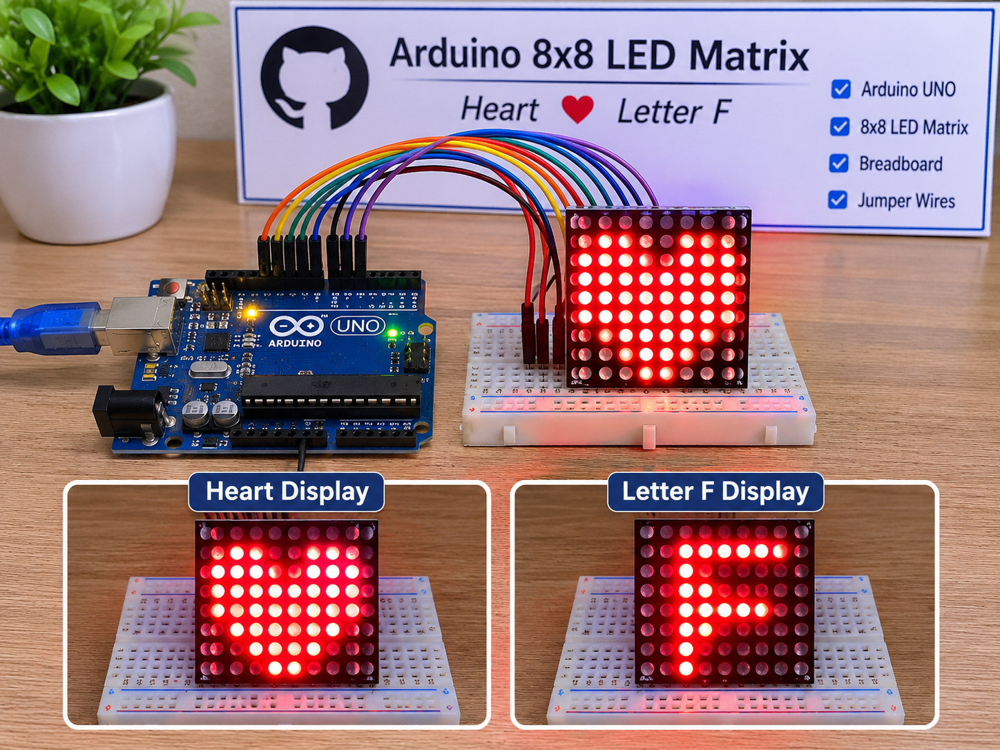
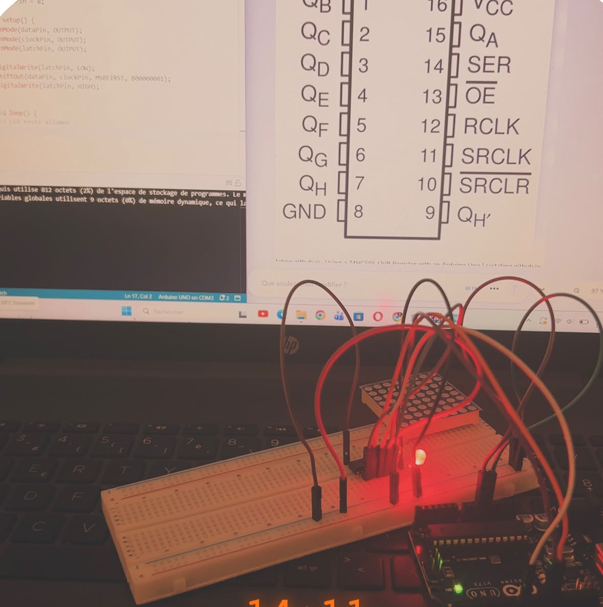
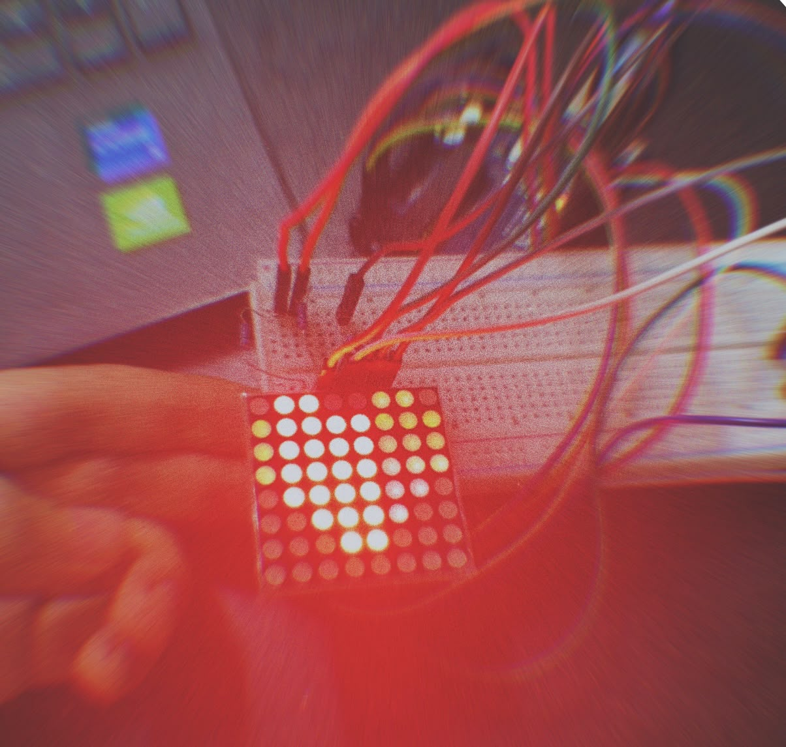
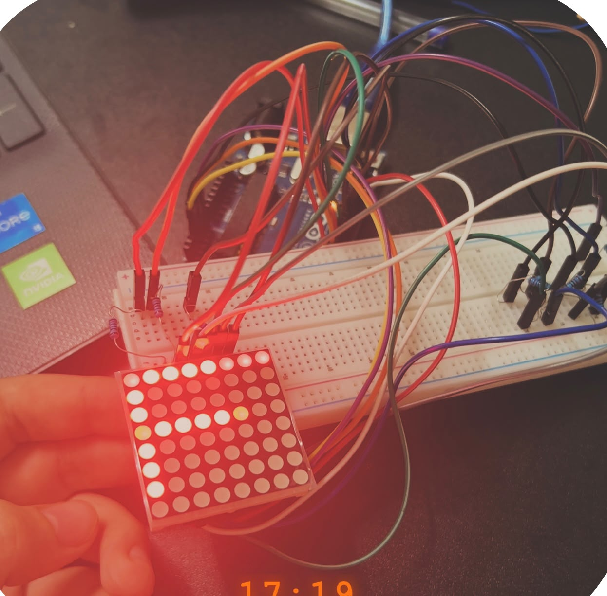

# Arduino 8x8 LED Matrix ❤️

## Project Description

This project is based on Arduino UNO and an 8x8 LED Matrix (1588BS).

It allows displaying different shapes and patterns using Arduino programming.

## Components Used

- Arduino UNO
- 8x8 LED Matrix (1588BS)
- 220Ω Resistors
- Breadboard
- Jumper Wires

## Project Features

- ❤️ Display a Heart
- Display the Letter F
- LED Matrix Pattern Control

## Project Photos

### Complete Project

### Heart Display

### Letter F Display

## Source Code

- [Heart Code](matrix_heart.ino)
- [Letter F Code](matrix_F.ino)

## Programming Language

C++ using Arduino IDE.

## Author

Ferdawess
